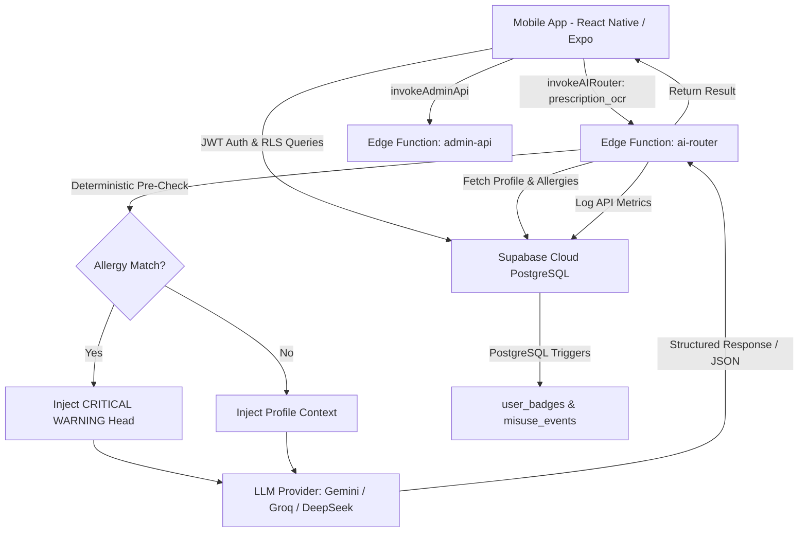

# MedSentry 🛡️💊
### AI-Powered Smart Antibiotic & Medication Management Platform

MedSentry is a state-of-the-art, mobile-first healthcare platform designed to combat **Antimicrobial Resistance (AMR)**, optimize prescription compliance, and empower families and caregivers with intelligent medication tracking. Built with React Native, Expo, Supabase Cloud PostgreSQL, and multi-model AI routing, MedSentry seamlessly blends clinical safety guardrails, OCR prescription scanning, family circle coordination, and real-time WHO AWaRe antibiotic surveillance.

---

## 🚀 Key Features & Modules

### 1. 📷 Smart OCR Prescription & Pill Strip Scanner
* **Hybrid 2-Tier OCR Engine**: Combines low-latency, on-device text recognition (**Google ML Kit**) with cloud-scale multimodal vision (**Google Gemini 1.5 Flash**) for maximum speed and accuracy.
* **2D Spatial Layout Reconstruction**: Gathers bounding coordinates from ML Kit blocks and clusters lines sharing the same horizontal band ($\Delta y \le 65\%$ line height), sorting columns left-to-right. Preserves physical tabular rows so medication names, dosages, frequencies, and durations are never misaligned across table cells.
* **Fuzzy Database Matching & Levenshtein Fallback**:
  * Employs PostgreSQL's native **`pg_trgm`** trigram similarity extension and GIN indexing (`idx_drugs_name_trgm`) via the `fuzzy_search_drug` database function.
  * Supplemented by client-side Levenshtein edit-distance calculations ($\ge 70\%$ similarity threshold) to effortlessly absorb OCR typographical errors (e.g. matching `Amoxlcillin` or `Paracetam0l` to their clean catalog counterparts).
* **Multimodal AI Handwriting Reader**:
  * An automated fallback and user-toggleable **"AI Doctor Handwriting Mode"** routes tricky or cursive prescriptions through the Supabase `ai-router` Edge Function to **Gemini 1.5 Flash Vision**.
  * Formats clinical prescriptions into structured JSON schemas containing patient demographics, diagnosed conditions, doctor registration details, and medication courses.
* **2D Barcode (GS1 DataMatrix & EAN-13) Auto-Scanner**:
  * Live camera stream automatically detects pharmaceutical **GS1 DataMatrix** 2D codes and standard barcodes.
  * Decodes Application Identifiers: `(01)` GTIN, `(17)` Expiry Date (`YYMMDD`), and `(10)` Batch Number, instantly warning users if a scanned medication has expired.
* **Clinical Verification Screen**: Interactive confirmation screen (`VerifyPrescriptionScreen.tsx`) allowing users to review, edit, and confirm extracted medicine names, doses, frequencies, and instructions prior to adding courses to their adherence tracker.

### 2. 🌍 WHO AWaRe Antibiotic Classification System
* **Stewardship Categorization**: Classifies every antibiotic into **Access**, **Watch**, **Reserve**, or **Not Recommended** tiers based on World Health Organization guidelines.
* **Misuse Heatmap & Risk Scoring**: Automatically flags high-risk antibiotic usage ($K \ge 5$ threshold for unprescribed/overused Watch & Reserve tier drugs) to promote responsible prescribing.

### 3. 🤖 AI Health Consultant & Multi-Model Router (`ai-router`)
* **Multi-Provider AI Routing**: Dynamically routes requests across **Google Gemini 1.5 Flash**, **Groq Llama 3**, and **DeepSeek AI** via Supabase Edge Functions.
* **Clinical Request Modes**:
  1. `suitability` — Cross-references candidate medicines against active courses, known conditions, and drug interactions.
  2. `symptom_to_care` — Analyzes symptoms, correlates side effects, and outputs AWaRe necessity flags (`necessary`, `not_necessary`, `unclear`).
  3. `visual_id` — Visual pill, blister strip, or packaging identification from captured images.
  4. `prescription_ocr` — Clinical multimodal extraction of complex and cursive handwritten doctor prescriptions.
* **Deterministic Server-Side Allergy Pre-Check**: Performs a pre-flight string/category match between the user's recorded allergies (`profiles.allergies`) and target drug data (`drugs.name`, `category`, `aware_class`), injecting a high-priority `CRITICAL SAFETY WARNING` before the LLM generates its response.
* **Structured Medical Context Injection**: Injects user demographics (age, weight, height), known conditions, recorded allergies, 7-day adherence trends, and active medication courses into system prompts.
* **3-Tier Clinical Guardrails**:
  1. **Pediatric Dosage Refusal**: Blocks automated pediatric dosing calculations and directs to licensed pediatricians.
  2. **Overdose Refusal**: Refuses fatal/lethal dose queries and provides immediate emergency hotline contact details.
  3. **Severe Self-Diagnosis Refusal**: Prevents AI diagnostic assertions for severe conditions (cancer, stroke, myocardial infarction).
* **Dual Interaction Modes**:
  * **Image Scan Consultant**: Visual pill/strip identification and suitability analysis via camera or gallery photos (`launchCameraAsync`).
  * **AI Conversational Chatbot**: Multi-turn routine-aware health assistant for daily medication advice.

### 4. 👨‍👩‍👧‍👦 Family Circles & Caregiver Self-Sovereignty
* **Shared Family Circles**: Create or join family groups via secure 6-character invite codes (`RAMIREZ2026`).
* **Role-Based Access Control (RBAC)**: Supports `OWNER`, `CAREGIVER`, and `VIEWER` roles.
* **Standing Caregiver Consent Management**: Empowers adult members to toggle caregiver edit permissions on/off (`caregiver_consent_revoked`) at any time for complete privacy sovereignty.
* **Caregiver Audit Trail**: Automatically logs every edit or dose logged by a caregiver on a dependent's behalf into `public.caregiver_audit_log`.
* **Medicine Cabinet Inventory**: Shared OTC inventory tracker with 30-day near-expiry warnings and stock management.

### 5. 🩺 Caregiver Dependent Profile Access
* **Interactive Member Cards**: Caregivers and circle members can tap any member card in `FamilyCircleScreen` to view their detailed profile (`MemberProfileScreen.tsx`).
* **Medical Safety Profile**: Displays age, weight, height, known medical conditions (*e.g. Type 2 Diabetes, Arthritis*), and drug allergies (*e.g. Sulfa*).
* **Dependent Course Overview**: Renders active medication courses, AWaRe badges, dosage schedules, and days-remaining progress bars.
* **Proxy Dose Logging**: Enables authorized caregivers to tap **"Log Dose for Member"** directly from the profile view to record adherence on their dependent's behalf.

### 6. 📔 Symptom Journal & Side-Effect Correlation
* **Rich Symptom Logging**: Record symptoms with 1–10 severity ratings, onset duration (`Just started`, `< 24h`, `1-3 days`, `4-7 days`, `> 1 week`), body system category tags (`Head & Brain`, `Stomach & Digestive`, `Skin & Rash`, `Respiratory`, `Muscle & Joint`, `General / Other`), and visual symptom photo attachments.
* **Medication Linking**: Links symptoms directly to active medication courses (`linked_course_id`) for side-effect correlation.
* **Status Toggles**: Easily toggle entries between `ongoing` and `resolved`.

### 7. 🔍 Direct Medicine Search & Custom Catalog Fallback
* **Typeahead Catalog Search**: Instant search querying 752 catalog drugs in `public.drugs`.
* **"Scan Instead" Secondary Path**: Prominent option navigating directly to OCR scanner.
* **Unmatched Custom Drug Fallback**: Option `"Can't find 'X'? Add as custom medication"` allows tracking 100% of unlisted drugs.
* **Analytics Demand Logging**: Logs unmatched drug searches into `public.api_usage_logs` (`provider_name = 'missing_drug_search'`) to track catalog expansion demand.

### 8. 🎮 Gamified Adherence & Automated Badges
* **Adherence Streak Tracking**: Automatically evaluates dose logging frequency via PostgreSQL database triggers (`trg_evaluate_badges` on `public.user_badges`).
* **Unlocked Badges**: Awards badges such as `first_dose_logged` and `7_day_streak`.

### 9. 📊 Admin Portal & Regional AMR Surveillance
* **Executive Dashboard**: System metrics on active users, antibiotic compliance rates, API usage logs, and dataset refresh status (`dataset_sync_log`).
* **Atomic Account Deletion**: Secure GoTrue Admin API integration ensuring clean multi-table user deletion.
* **Community Misuse Heatmap**: Opt-in anonymized state/province regional tracking (`profiles.region`).

---

## 📊 Datasets Used & Clinical Sources

1. **WHO AWaRe Classification Dataset (2023)**:
   * 750+ essential medicines categorized into **Access**, **Watch**, **Reserve**, and **Not Recommended** antibiotic tiers.
   * Embedded into `public.drugs.aware_class`.
2. **FDA & DailyMed Reference Drug Database**:
   * Drug formulations, common clinical uses, side effects, and warning notes stored in `public.drugs`.
   * Drug-drug interaction pairs and severity descriptions stored in `public.drug_interactions`.
3. **Regional Opt-In Surveillance Data**:
   * Anonymized State/Province region strings stored in `public.profiles.region` powering the regional AMR misuse heatmap without compromising user privacy.

---

## 🛠️ Technology Stack

### Frontend & Mobile Application
* **Framework**: React Native with Expo SDK (EAS CLI & EAS Build)
* **Language**: TypeScript (Strict Mode)
* **Navigation**: React Navigation v6 (Native Stack + Material Top Tabs)
* **Styling**: Organic & Balanced Design System (`mobile-app/src/theme/colors.ts`) with custom glassmorphism effects and WCAG AA accessible contrast tokens.
* **Animations**: React Native Reanimated v3 (Smooth micro-animations & layout transitions)
* **Icons**: Custom vector icons powered by `lucide-react-native`
* **On-Device OCR**: Google ML Kit (`react-native-mlkit-ocr`) with 2D spatial Y/X coordinate line clustering.
* **Camera & Hardware Scanning**: `expo-camera` with live GS1 DataMatrix (2D), QR, and EAN-13 barcode parsing, and `expo-image-picker` for gallery uploads.

### Backend & Database Infrastructure
* **Database**: Supabase Cloud PostgreSQL 15
* **Fuzzy Search & Indexing**: PostgreSQL **`pg_trgm`** extension with GIN trigram indexing (`idx_drugs_name_trgm`) and `public.fuzzy_search_drug` RPC function.
* **Security & RLS**: 100% Row Level Security (RLS) enforcement with `SECURITY DEFINER` PostgreSQL functions (`check_caregiver_access`, `check_circle_read_access`).
* **Database Triggers**: Automated badge unlock triggers (`trg_evaluate_badges`) and AMR misuse event tracking (`trg_track_misuse`).
* **Serverless Edge Functions**: Deno / TypeScript Edge Functions:
  * `ai-router`: Multi-model AI request handler with `prescription_ocr`, `suitability`, `symptom_to_care`, and `visual_id` modes, guardrail enforcement, and deterministic allergy pre-check.
  * `admin-api`: Privileged service-role administrative portal operations.
  * `verify-email`: Verification email dispatch via Resend API.

### AI APIs & LLM Providers
* **Google Gemini API**: `gemini-flash-lite-latest` (Multimodal image analysis, doctor prescription handwriting extraction, and fast inference)
* **Groq API**: `llama-3.3-70b-versatile` (High-speed conversational chatbot)
* **DeepSeek AI API**: Secondary model fallback

---

## 🏗️ System Architecture



---

## 🗄️ Database Schema Summary

| Table / Object | Description |
| :--- | :--- |
| `profiles` | User demographics (`age`, `weight_kg`, `height_cm`), `known_conditions`, `allergies`, `caregiver_consent_revoked`, `region`, and `is_admin`. |
| `medication_courses` | Tracked prescriptions (`drug_id`, `custom_name`, `dosage_amount`, `frequency`, `instructions`, `total_pills`, `daily_dose`, `days_remaining`, `necessity_flag`, `expiry_date`, `batch_number`). |
| `dose_logs` | Adherence logging (`course_id`, `taken_at`, `status`). |
| `symptom_journal` | Symptom entries (`symptom`, `severity`, `status`, `linked_course_id`, `category_location`, `duration_onset`, `image_url`). |
| `drugs` | Catalog reference table (752 rows) containing `name`, `category`, `aware_class`, `common_uses`, `side_effects`. Indexed with GIN Trigram (`idx_drugs_name_trgm`). |
| `fuzzy_search_drug(text[])` | Stored RPC function for fault-tolerant fuzzy OCR candidate matching. |
| `drug_interactions` | Pairwise interaction data (`drug_a_id`, `drug_b_id`, `severity`, `description`). |
| `family_groups` | Family circles with unique 6-character `invite_code` and `owner_id`. |
| `family_members` | Circle membership mapping (`group_id`, `member_id`, `role`, `is_linked_dependent`). |
| `cabinet_inventory` | Shared OTC medicine cabinet items (`drug_id`, `quantity`, `expiry_date`). |
| `caregiver_audit_log` | Audit logs of edits/actions made by caregivers on dependents' behalf (`caregiver_id`, `target_member_id`, `action`, `details`). |
| `user_badges` | Gamified adherence badges awarded to users (`badge_type`, `unlocked_at`). |
| `misuse_events` | Anonymized AMR misuse tracking events (`course_id`, `event_type`, `aware_tier`, `region`). |
| `api_usage_logs` | AI & search demand usage analytics (`provider_name`, `request_type`, `outcome`, `latency_ms`). |
| `dataset_sync_log` | Refresh logs for backend datasets (`dataset_name`, `status`, `details`). |

---

## 📱 Expo EAS Build & Mobile Distribution

The mobile application has been configured for building and uploading via **Expo Application Services (EAS CLI & EAS Build)**.

### Rebuilding & Uploading to EAS

1. **Install Expo & EAS CLI**:
   ```bash
   npm install -g eas-cli expo-cli
   ```

2. **Navigate to Mobile App Directory**:
   ```bash
   cd mobile-app
   ```

3. **Configure / Login to EAS**:
   ```bash
   eas login
   eas project:init
   ```

4. **Build Android Package (`.apk` or `.aab`)**:
   ```bash
   # Build preview APK for testing on physical devices
   eas build --platform android --profile preview

   # Build production AAB for Google Play Store upload
   eas build --platform android --profile production
   ```

5. **Build iOS Application (`.ipa`)**:
   ```bash
   eas build --platform ios --profile production
   ```

6. **Submit / Upload to App Stores**:
   ```bash
   eas submit --platform android
   ```

---

## 💻 Local Setup & Installation

### Prerequisites
* Node.js v18+
* Expo CLI & React Native environment
* Supabase CLI (`npx supabase`)
* Python 3.10+ (for database verification scripts)

### Installation Steps

1. **Clone the Repository**:
   ```bash
   git clone https://github.com/Subhash-777/MedSentry.git
   cd MedSentry
   ```

2. **Install Mobile Dependencies**:
   ```bash
   cd mobile-app
   npm install
   ```

3. **Environment Setup**:
   Create a `mobile-app/.env` file:
   ```env
   EXPO_PUBLIC_SUPABASE_URL=https://your-project.supabase.co
   EXPO_PUBLIC_SUPABASE_ANON_KEY=your-anon-key
   GEMINI_API_KEY=your-gemini-key
   GROQ_API_KEY=your-groq-key
   ```

4. **Run Database Migrations (Supabase)**:
   ```bash
   npx supabase db push
   ```

5. **Deploy Supabase Edge Functions**:
   ```bash
   npx supabase functions deploy ai-router --project-ref your-project-ref
   npx supabase functions deploy admin-api --project-ref your-project-ref
   ```

6. **Start Mobile Development Server**:
   ```bash
   cd mobile-app
   npx expo start
   ```

---

## 🛡️ Credential Hygiene & Security Notice

* All live secrets (API keys, Supabase Service Role keys, database connection strings) are strictly stored in environment variables (`.env`) and Supabase Edge Function Secrets.
* Demo review credentials are documented separately in `docs/DEMO_CREDENTIALS.md`, which is strictly ignored by `.gitignore`. Zero real-world credential reuse is permitted.

---

## 📜 License & Governance

MedSentry is developed as a healthcare technology platform targeting Antimicrobial Resistance mitigation. Designed for patient safety, clinical compliance, and public health surveillance.
